<div align="center">

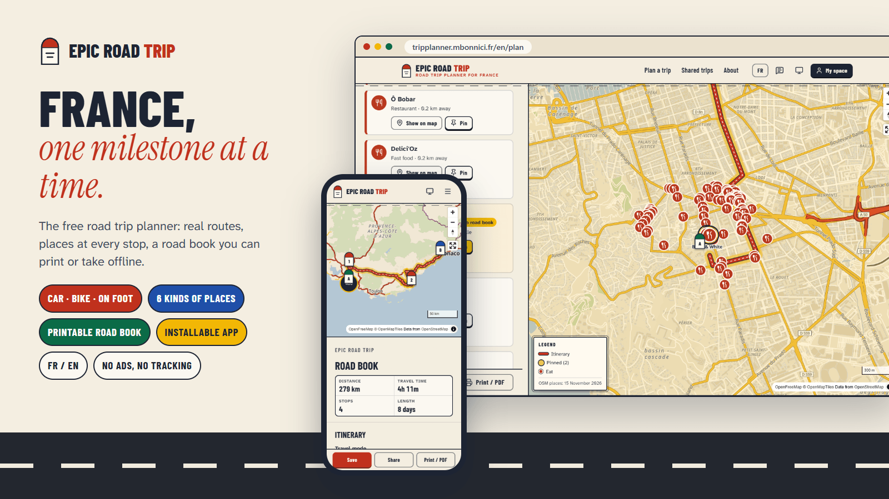

# Epic Road Trip

### France, one milestone at a time.

**The free road trip planner for France.** Draw the real route by car, bike or on foot, add up to 12 stops, find where to eat, sleep, explore and refuel around each one, and leave with a road book you can print, share or take offline. No account, no ads, no tracking.

[**Open the planner →**](https://tripplanner.mbonnici.fr) &nbsp;·&nbsp; [Shared trips](https://tripplanner.mbonnici.fr/en/trips) &nbsp;·&nbsp; [API docs](https://tripplanner.mbonnici.fr/api/docs/) &nbsp;·&nbsp; [Changelog](CHANGELOG.md) &nbsp;·&nbsp; [Security](SECURITY.md) &nbsp;·&nbsp; [Report a bug](https://github.com/ImMaxence/Epic-Road-Trip-Planner/issues/new)


</div>

---

## Why Epic Road Trip?

Most route planners stop at "how do I get there". Epic Road Trip is built for the journey itself.

| | |
|---|---|
| 🛣️ **The real road, leg by leg** | Car, bike or walking routes that follow the matching network (roads, cycle lanes, footpaths), with distance and travel time for every leg. |
| 📍 **Something to do at every stop** | Restaurants, wine bars, guest houses, campsites, castles, viewpoints, fuel and EV charging within 2 to 20 km of each stop, from OpenStreetMap places refreshed every month. |
| 📒 **A road book you keep** | Pin the addresses you like, save the trip, print a clean A4 road book or a PDF. |
| 🔗 **Share in one scan** | One link carries the whole trip, pinned places included. Show the QR code, scan it with your phone, and you're ready to go. |
| 🗺️ **A map that feels like a road atlas** | The signature *Atlas* basemap brings back paper road maps (cream paper, red motorways, yellow trunk roads), plus *Day* and *Night* styles. |
| 📲 **Installable, works offline** | Add it to your home screen like an app; pages you've visited stay available without signal. |

> **Nothing to sign up for.** Trips and favourites stay in your browser, never on our server. A share link or an export file moves them to another device.

## A closer look

<table>
  <tr>
    <td width="62%">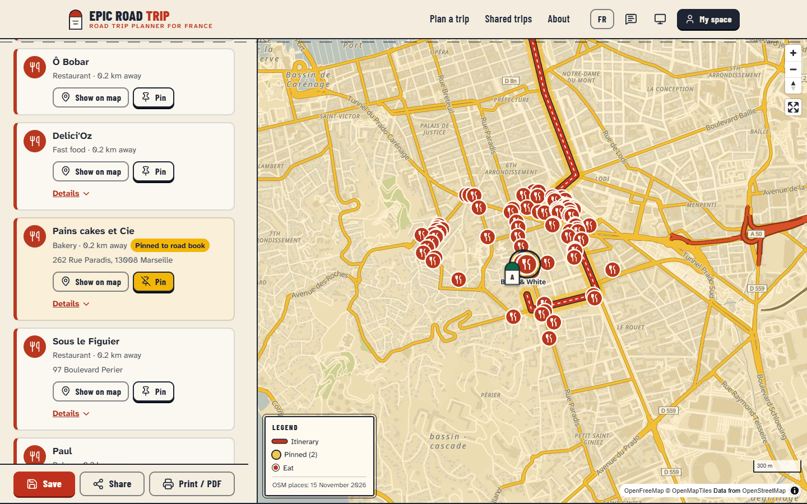</td>
    <td width="38%">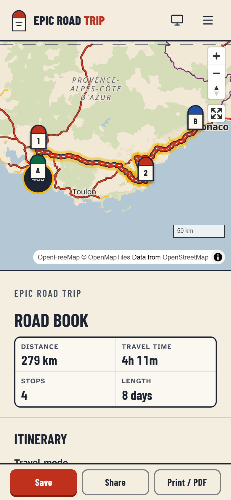</td>
  </tr>
  <tr>
    <td><b>Plan and explore.</b> Stops become French kilometre milestones. Places show up both on the map and in an accessible list, one category at a time. Pinned addresses glow gold.</td>
    <td><b>On the road.</b> Fully responsive, down to 320 px wide, and installable as an app.</td>
  </tr>
  <tr>
    <td>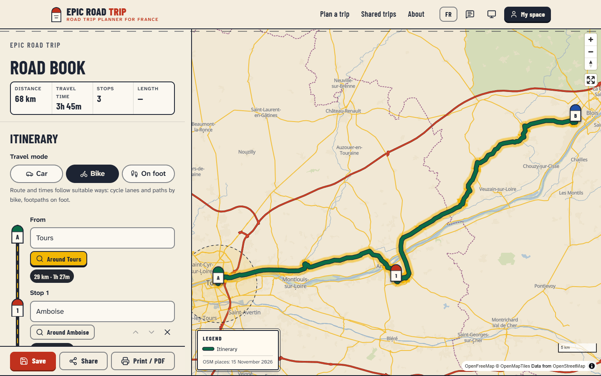</td>
    <td>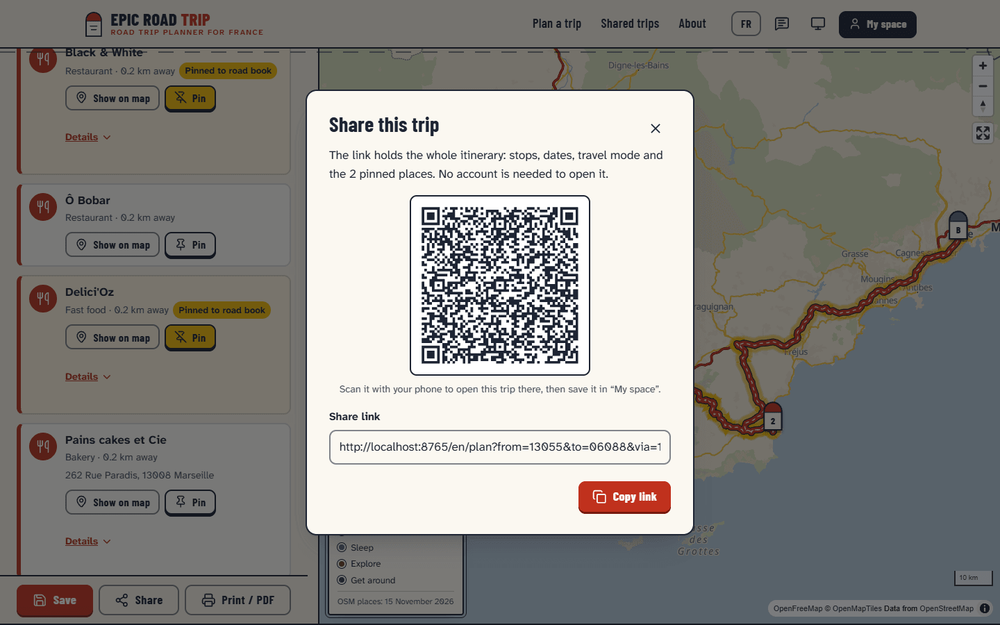</td>
  </tr>
  <tr>
    <td><b>Car, bike or on foot.</b> Pick a travel mode and the route switches to cycle lanes or footpaths, with travel times to match.</td>
    <td><b>Share without an account.</b> Stops, dates, travel mode and pinned places all fit in one link, also shown as a QR code.</td>
  </tr>
  <tr>
    <td>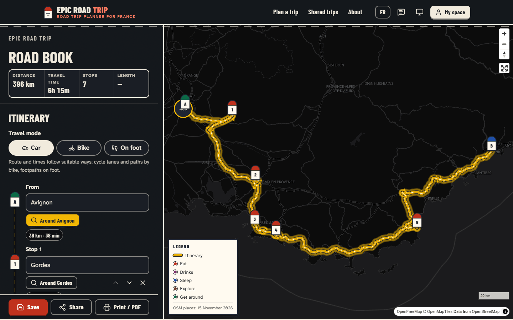</td>
    <td>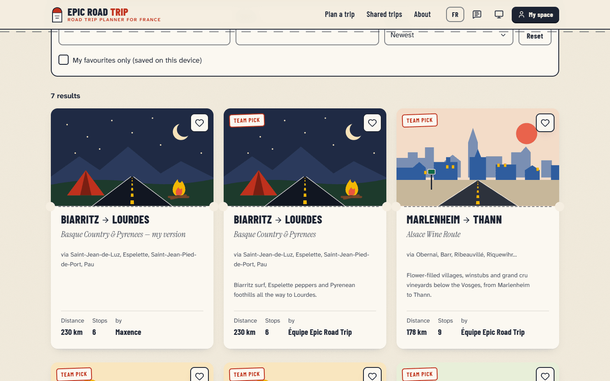</td>
  </tr>
  <tr>
    <td><b>Night drive.</b> A dark theme with retro-reflective road signs that follows your system preference.</td>
    <td><b>Shared trips.</b> A curated gallery of classics to start from: Great Alpine Road, Loire châteaux, Provence, Brittany, Alsace, Basque Country.</td>
  </tr>
</table>

## Features

**Plan**
- Search all 34,969 French communes (official INSEE data), accent-insensitive and ranked by population.
- Start, finish and up to 12 stops (reorder them with buttons), plus optional travel dates.
- Car, bike or walking routes through OSRM, with a clearly labelled straight-line fallback.
- Readable URLs built on INSEE codes: `/en/plan?from=13055&to=75056&via=69123&mode=bike`.

**Explore**
- Six categories around any stop: *Eat*, *Drinks*, *Sleep*, *Explore*, *Get around*, *Events*. Filter them one at a time, or see the closest places of each.
- Opening hours, cuisine, phone, website and wheelchair access when known.
- Clustered markers, a radius circle and a list kept in sync with the map. The legend shows the date of the last data refresh.

**Keep and share**
- Pin places to your road book, grouped by stop, and highlighted on the map.
- Save trips and favourites **on your device**: export them as a file, import them on another device, or erase them in one click.
- Share a link or **QR code** that holds the full trip, pinned places included. Nothing is stored on the server.
- Print a road book with the map, legs, distances and pinned places, or save it as a PDF.
- **Installable PWA:** home-screen icon, full-screen launch, offline access to visited pages, cached map tiles, and install help on iPhone and iPad.
- **Feedback / bug button** on every page: opens a pre-filled GitHub issue or an e-mail.

**Run the site** (owner)
- Administrators sign in with Google (addresses listed in `ADMIN_EMAILS`) to publish their own itineraries in the gallery, and to unpublish or delete any trip.
- **Map data on demand:** see when the OpenStreetMap places were last rebuilt and start an update with one click. The current data keeps serving until the new index is ready, and saved trips are never affected.

<table>
  <tr>
    <td width="50%">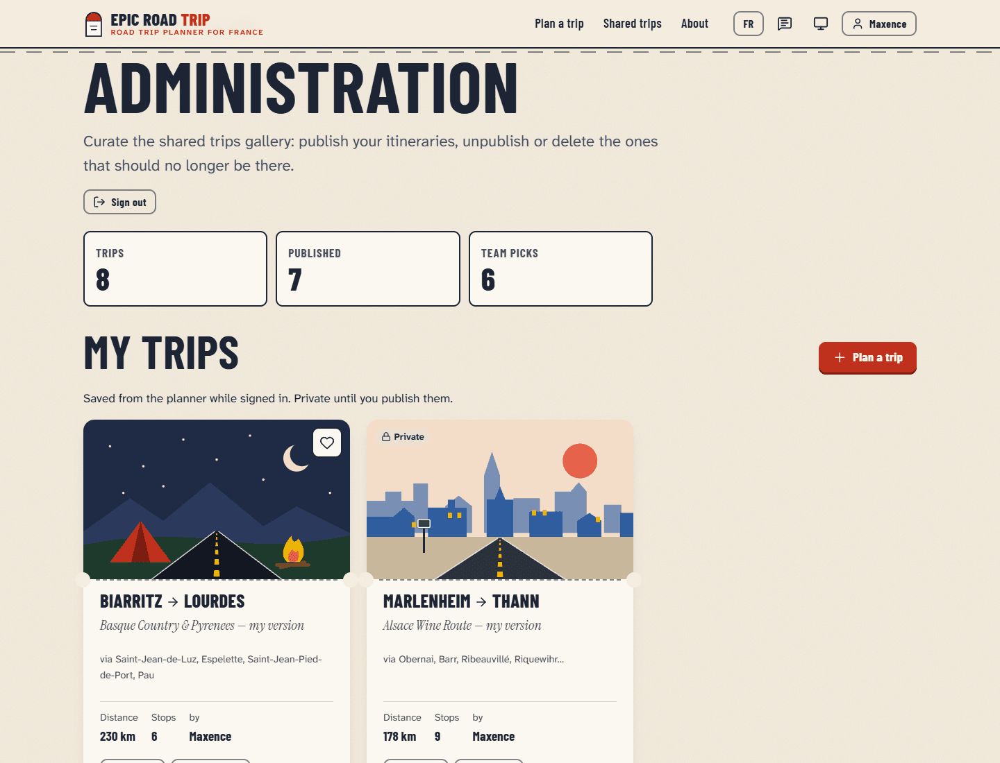</td>
    <td width="50%">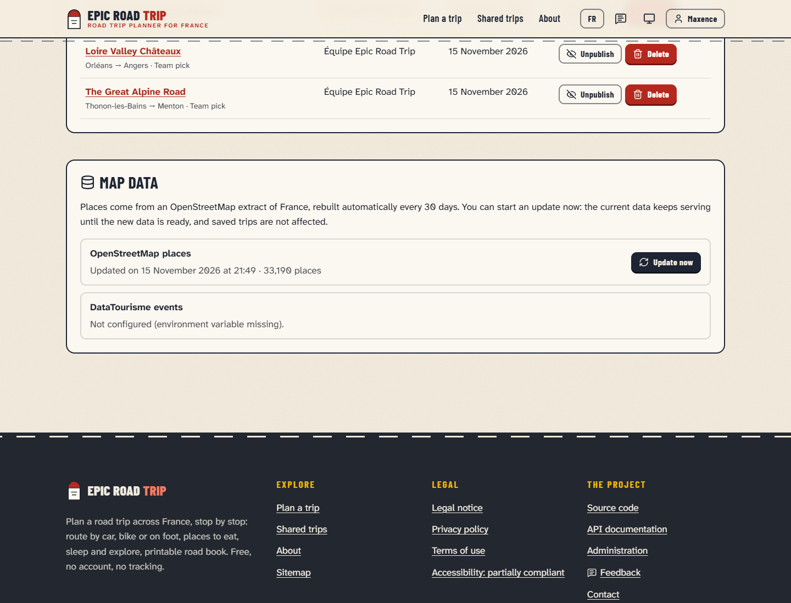</td>
  </tr>
  <tr>
    <td><b>Curate the gallery.</b> Publish your own road trips, keep them private, or take any trip down. One Google sign-in away, invisible to visitors.</td>
    <td><b>Fresh data in one click.</b> Last rebuild date, number of places, live progress, and a manual "Update now" next to the automatic monthly refresh.</td>
  </tr>
</table>

<table>
  <tr>
    <td width="62%">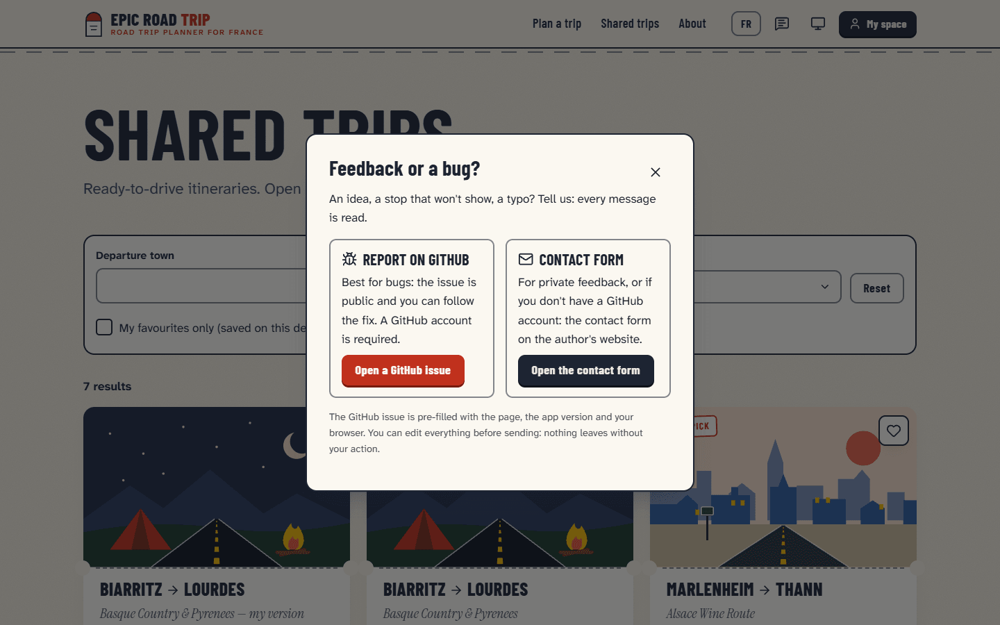</td>
    <td width="38%">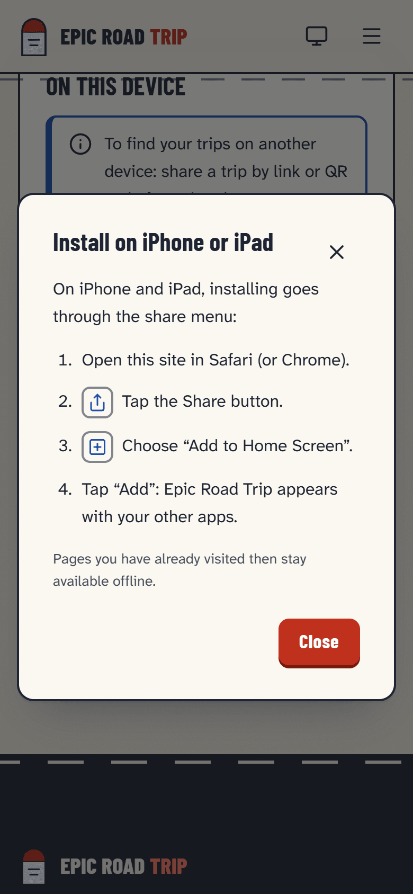</td>
  </tr>
  <tr>
    <td><b>Feedback in two clicks.</b> A pre-filled GitHub issue (page, version, browser) or an e-mail. The address never appears in the page, out of reach of scrapers.</td>
    <td><b>Install anywhere.</b> One-tap install on Android and desktop Chrome or Edge, step-by-step help on iPhone and iPad.</td>
  </tr>
</table>

## Built for everyone

| | |
|---|---|
| ♿ **Accessibility** | React Aria components, skip link, focus moved to the page title on navigation, high-visibility focus ring, live status messages, reduced motion, reflow at 320 px. Every page and dialog is checked with axe-core in light and dark themes. See the [accessibility statement](https://tripplanner.mbonnici.fr/en/accessibility). |
| 🌍 **Two languages** | French and English with localised URLs, `hreflang` alternates and a language switcher that keeps your page. |
| 🔒 **Privacy by design** | No visitor accounts, no cookies for visitors, no ads, no analytics, no third-party script: map tiles are proxied, so browsers never load external code. Strict CSP, rate limiting. See [SECURITY.md](SECURITY.md). |
| 🔎 **SEO & AI SEO** | Pre-rendered pages, canonical URLs, Open Graph cards, JSON-LD (WebApplication, FAQPage, BreadcrumbList), `sitemap.xml`, plus `llms.txt` / `llms-full.txt` and an explicit welcome for AI crawlers. |
| ⚡ **Lighthouse** | 100 in Accessibility, Best practices and SEO on every page; 100 in Performance on desktop. |

## Under the hood

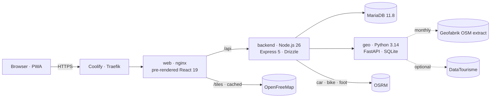

| Layer | Technology |
|---|---|
| Front end | React 19, React Router 8 (pre-rendering, no runtime server), TypeScript 7, Vite 8, React Aria, MapLibre GL 6, TanStack Query, service worker (offline pages, cached assets and tiles) |
| Back end | Node.js 26 (native TypeScript), Express 5, Drizzle ORM, zod, Google OAuth 2.0 for administrators (authorization code + PKCE), jose (JWT in HttpOnly cookie), helmet, rate limiting, OpenAPI 3.1 |
| Geo service | Python 3.14, FastAPI, SQLite, osmium-tool (OpenStreetMap extract → POI index), optional DataTourisme ingestion |
| Data | INSEE communes (geo.api.gouv.fr), OpenStreetMap, OpenFreeMap tiles, OSRM routing (FOSSGIS), DataTourisme events |
| Ops | Docker Compose, nginx (CSP, cache, tile proxy), Coolify, GitHub Actions |
| Quality | Vitest (unit + MariaDB integration), pytest, Playwright end-to-end + axe-core accessibility |

```
.
├── frontend/       React app, service worker, nginx config, SEO files (robots, llms.txt, sitemap generator)
├── backend/        REST API, SQL migration, curated trips, tests
├── geo-service/    Commune search, OSM/DataTourisme ingestion, POI queries, tests
├── e2e/            Playwright end-to-end and accessibility tests, screenshot generator
├── docker-compose.yml   Production stack (Coolify)
└── compose.local.yml    Local overrides (Docker Desktop)
```

## Quick start

Requirements: **Docker Desktop**.

```bash
git clone https://github.com/ImMaxence/Epic-Road-Trip-Planner.git
cd Epic-Road-Trip-Planner
cp .env.example .env            # defaults are fine locally; compose.local.yml switches URLs to localhost
docker compose -f docker-compose.yml -f compose.local.yml up -d --build
```

Open **http://localhost:8765**. On first start the geo service downloads a regional OpenStreetMap extract (Provence-Alpes-Côte d'Azur, ~400 MB, about a minute of processing). Places elsewhere in France appear once you switch `OSM_EXTRACT_URL` to the full France extract. Use `LOCAL_PORT` in `.env` if port 8765 is taken.

## Deploy on Coolify

1. **New resource → Docker Compose** (from this Git repository), compose file `docker-compose.yml`.
2. **Domain:** on the `web` service, set `https://tripplanner.mbonnici.fr` (port 80). Coolify issues the certificate and routes traffic; no port is published.
3. **Environment:** set `PUBLIC_URL=https://tripplanner.mbonnici.fr`. The database credentials and secrets (`SERVICE_USER_MARIADB`, `SERVICE_PASSWORD_MARIADB`, `SERVICE_PASSWORD_MARIADBROOT`, `SERVICE_PASSWORD_64_JWT`, `SERVICE_PASSWORD_GEOADMIN`) are generated by Coolify automatically.
4. **Administration (optional):** in Google Cloud Console create an OAuth client of type *Web application* with the authorised redirect URI `https://tripplanner.mbonnici.fr/api/auth/google/callback`. Then set `GOOGLE_CLIENT_ID`, `GOOGLE_CLIENT_SECRET` and `ADMIN_EMAILS` (e.g. `me@gmail.com` or a whole domain `@mbonnici.fr`). Visitors never need any of this.
5. **Feedback (optional):** set `FEEDBACK_EMAIL` to offer an e-mail option next to GitHub issues. The address is never written in the pages (it is rebuilt when someone clicks), but anyone who sends feedback will see it, so an alias is a good idea.
6. **Deploy.** The database migrates itself and the six curated trips are created on first boot. The geo service downloads the France OpenStreetMap extract (~5 GB) and builds its index in the background (≈20 minutes), then refreshes it monthly. Until the index is ready, places come from the public Overpass API when available.
7. **Behind Cloudflare:** set `TRUST_CLOUDFLARE=true` and keep SSL mode on *Full (strict)*. If you want AI assistants to read the site, check that *Block AI bots* / *AI Crawl Control* is not blocking them.
8. **Search engines:** submit `https://tripplanner.mbonnici.fr/sitemap.xml` in Google Search Console (and Bing Webmaster Tools).

### Configuration

| Variable | Default | Purpose |
|---|---|---|
| `PUBLIC_URL` | `https://tripplanner.mbonnici.fr` | Canonical URLs, sitemap, secure cookies, CSRF origin check |
| `SERVICE_USER_MARIADB` / `SERVICE_PASSWORD_MARIADB` | generated | Database user |
| `SERVICE_PASSWORD_MARIADBROOT` | generated | Database root password |
| `SERVICE_PASSWORD_64_JWT` | generated | Session signing secret (≥ 32 characters) |
| `GOOGLE_CLIENT_ID` / `GOOGLE_CLIENT_SECRET` | — | Google OAuth Web client for administrators; redirect URI `<PUBLIC_URL>/api/auth/google/callback` |
| `SERVICE_PASSWORD_GEOADMIN` | generated | Shared secret letting the backend ask the geo service for a manual data refresh |
| `ADMIN_EMAILS` | — (no administration) | Comma-separated e-mails and/or `@domain` entries allowed to administer; removing an entry revokes its session at once |
| `FEEDBACK_EMAIL` | — (GitHub issues only) | Address offered by the "Feedback / bug" button |
| `DATATOURISME_FEED_URL` | — | DataTourisme feed URL for dated events ([free account](https://info.datatourisme.fr/)) |
| `OSM_EXTRACT_URL` | France extract | Any [Geofabrik](https://download.geofabrik.de/europe/france.html) `.osm.pbf`; a region suits smaller servers |
| `OSM_REFRESH_DAYS` | `30` | How often the extract is rebuilt |
| `OSRM_CAR_URL` / `OSRM_BIKE_URL` / `OSRM_FOOT_URL` | FOSSGIS servers (`routing.openstreetmap.de/routed-car` …) | One OSRM engine per travel mode; point to your own instances for heavy use |
| `TRUST_CLOUDFLARE` | `false` | Set to `true` when the domain is proxied by Cloudflare, so rate limiting uses the real visitor IP |

Manual data refresh: the **Update now** button in the administration, or `docker compose exec geo python -m app.cli ingest-osm` (or `ingest-datatourisme`).

## Development

```bash
# API (Node ≥ 24) — needs MariaDB and the geo service
cd backend && npm install && npm run dev
# Front end — proxies /api to localhost:8080 and /tiles to OpenFreeMap
cd frontend && npm install && npm run dev
```

| Command | What it checks |
|---|---|
| `cd backend && npm run typecheck && npm test` | Types, unit tests; set `TEST_DATABASE_HOST` to also run the MariaDB integration suite |
| `cd frontend && npm run typecheck && npm test && npm run build` | Types, unit tests, pre-rendered build |
| `docker build --target test geo-service` | Geo service tests (pytest) |
| `cd e2e && npm install && npx playwright test` | End-to-end journeys and axe-core accessibility audit against a running stack |
| `cd e2e && node screenshots.mjs` | Regenerates the README, PWA and Open Graph images from a running local stack |

## API

The public REST API is documented with OpenAPI 3.1 at [`/api/docs`](https://tripplanner.mbonnici.fr/api/docs/) ([JSON](https://tripplanner.mbonnici.fr/api/openapi.json)).

```bash
curl "https://tripplanner.mbonnici.fr/api/places/search?q=annecy"
curl "https://tripplanner.mbonnici.fr/api/route?points=47.394,0.6848;47.5861,1.3359&mode=bike"
curl "https://tripplanner.mbonnici.fr/api/pois?lat=45.899&lon=6.129&radius=5&lang=en"
```

Public endpoints are rate-limited per IP (routing 40/min, places of interest 90/min).

## The story

Epic Road Trip started in **2024** as a team project at **Epitech Marseille**, built by
[Maxence Bonnici](https://github.com/ImMaxence), [Maxence Laporte](https://github.com/TheMaxquent),
[Meriem Boussaid](https://github.com/boussaidm) and [Federico Suarez](https://github.com/FedeSCode)
(the original brief is in [`doc/`](doc/)). In **2026** Maxence Bonnici redesigned and rebuilt it from the ground up: new identity, real car/bike/foot routing, OpenStreetMap places, sharing by link and QR code, installable app, English version, legal pages and accessibility.
See the [changelog](CHANGELOG.md).

## License & credits

Code released under the [MIT License](LICENSE) © 2024–2026 Maxence Bonnici and the Epic Road Trip contributors.
Map data © [OpenStreetMap contributors](https://www.openstreetmap.org/copyright) (ODbL) · Basemap [OpenFreeMap](https://openfreemap.org) / © OpenMapTiles ·
Communes INSEE / La Poste via [geo.api.gouv.fr](https://geo.api.gouv.fr) (Licence Ouverte) · Routing [OSRM](https://project-osrm.org) ·
Events [DataTourisme](https://www.datatourisme.fr) (Licence Ouverte) · QR codes [uqr](https://github.com/unjs/uqr) (MIT) · Typefaces Barlow Condensed, Atkinson Hyperlegible Next, Instrument Serif (SIL OFL) · Icons [Lucide](https://lucide.dev) (ISC).
